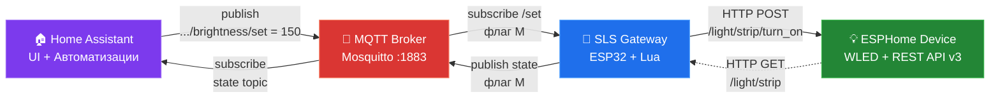

```bash
cat > ~/Downloads/README.md << 'MDEOF'
# 🔌 Интеграция ESPHome с SLS шлюзом через REST API v3

[](https://esphome.io)
[](https://slsys.io)
[](https://home-assistant.io)
[](https://mosquitto.org)
[](LICENSE)

Полное руководство по управлению устройствами ESPHome через REST API v3 из Lua-скриптов SLS с интеграцией в Home Assistant через MQTT.

---

## 📑 Содержание

- [Введение](#введение)
- [🏗️ Архитектура](#️-архитектура)
- [⚠️ Критически важно: Регистр букв](#️-критически-важно-регистр-букв)
- [Критические особенности ESPHome REST API v3](#критические-особенности-esphome-rest-api-v3)
- [Управление компонентами ESPHome](#управление-компонентами-esphome)
- [Интеграция с SLS шлюзом](#интеграция-с-sls-шлюзом)
- [init.lua — Обязательная инициализация](#initlua--обязательная-инициализация)
- [Интеграция с Home Assistant через MQTT](#интеграция-с-home-assistant-через-mqtt)
- [Полный пример: управление LED-лентой](#полный-пример-управление-led-лентой)
- [Управление цветом RGB через HEX-код](#управление-цветом-rgb-через-hex-код)
- [Отладка](#отладка)
- [FAQ](#faq)

---

## Введение

**ESPHome** — фреймворк для прошивки ESP32/ESP8266 устройств. Начиная с версии 2026.x, ESPHome включает встроенный веб-сервер с REST API для управления компонентами без Home Assistant или MQTT.

Эта инструкция описывает, как интегрировать ESPHome устройства с **SLS шлюзом** через Lua-скрипты, используя HTTP REST API, и пробросить управление в **Home Assistant** через MQTT. Всё работает локально.

### Преимущества подхода:

- ✅ 100% локальная работа — не зависит от интернета или VPN
- ✅ Задержка менее 100 мс
- ✅ Не требует MQTT-брокера для базовой работы (но рекомендуется для HA)
- ✅ Совместимо с любой версией SLS, поддерживающей Lua и HTTP
- ✅ Двусторонняя синхронизация между HA и ESPHome через SLS

---

## 🏗️ Архитектура



### Как это работает (пошагово):

1. **Пользователь** двигает ползунок яркости в Home Assistant UI
2. **HA** публикует значение в MQTT топик: `[prefix]/obj/detskaya_wled.brightness/set = 150`
3. **MQTT брокер** доставляет сообщение всем подписчикам
4. **SLS** автоматически подписан на топик `/set` (благодаря флагу M) и получает сообщение
5. **SLS** обновляет объект `detskaya_wled.brightness = 150`
6. **Флаг W** запускает скрипт `detskaya_wled.lua`
7. **Скрипт** делает HTTP POST на ESPHome: `/light/strip/turn_on?brightness=150`
8. **ESPHome** применяет яркость к LED-ленте
9. **SLS** публикует новое состояние в MQTT: `[prefix]/obj/detskaya_wled.brightness = 150` (флаг M)
10. **HA** получает состояние и обновляет UI

### ✅ Ключевые моменты:

- SLS автоматически подписывается на топики `/set` благодаря флагу M — никакого явного `mqtt.sub()` не нужно
- Все имена объектов — строчными буквами для совместимости с HA
- init.lua принудительно устанавливает скрипты и флаги при каждой загрузке
- Полный цикл: HA → MQTT → SLS → HTTP → ESPHome → MQTT → HA

---

## ⚠️ КРИТИЧЕСКИ ВАЖНО: Регистр букв

> 🚨 **Это главная проблема, на которой ломается 90% интеграций!**
>
> MQTT чувствителен к регистру. `ZigbeeGate` и `ZIgbeeGate` — это **два разных топика**. То же самое с именами объектов: `detskaya_WLED` и `detskaya_wled` — это разные объекты в SLS.

### Правила, которые нужно соблюдать:

1. **Все имена объектов в SLS — строчными буквами** (например, `detskaya_wled.brightness`, а не `detskaya_WLED.brightness`). Это потому что HA при MQTT Discovery генерирует топики в нижнем регистре.

2. **Системный префикс SLS — точно как в настройках**. Посмотри в SLS → Settings → MQTT → "Системный префикс топика". Используй его везде.

3. **Имена компонентов ESPHome — только латиница в нижнем регистре**. Например, `strip`, `effect_speed`, а не `Strip` или `EffectSpeed`.

4. **Топики MQTT должны совпадать везде**: в init.lua, в скриптах SLS, в конфиге HA, в MQTT Explorer. Любое расхождение в регистре = неработающая интеграция.

### Пример правильной иерархии имён:

```
SLS объект:      detskaya_wled.brightness       (строчные)
MQTT топик:      [prefix]/obj/detskaya_wled.brightness
MQTT /set:       [prefix]/obj/detskaya_wled.brightness/set
HA command:      [prefix]/obj/detskaya_wled.brightness/set
HA state:        [prefix]/obj/detskaya_wled.brightness
ESPHome entity:  strip                          (латиница, строчные)
```

> ⚠️ Если у тебя уже есть объекты с разным регистром — удали дубликаты в SLS и приведи всё к единому регистру. Иначе будут "фантомные" объекты, которые появляются в MQTT, но не имеют скриптов.

---

## Критические особенности ESPHome REST API v3

> ⚠️ **Внимание!** Эти особенности не очевидны из документации и являются результатом реального тестирования. Их игнорирование приводит к ошибкам 404, 411 и молчаливому игнорированию команд.

### 1. Content-Length обязателен для POST

Любой POST-запрос должен содержать заголовок `Content-Length`, иначе ESPHome вернёт ошибку `411 Length Required`. Это требование ESP-IDF HTTP-сервера.

```lua
-- Правильно:
local headers = "Content-Length: 2\r\n"
local body = "{}"

-- Неправильно (вернёт 411):
http.request(url, "POST")
```

### 2. Параметры в URL, а не в теле запроса

ESPHome web_server **игнорирует JSON-тело** для команд управления. Все параметры передаются через query-строку URL:

```lua
-- Правильно (параметр brightness в URL):
local url = "http://<IP>/light/strip/turn_on?brightness=150"

-- Неправильно (параметр в JSON-теле — будет проигнорирован):
local body = '{"brightness":150}'
```

### 3. Только латиница в именах компонентов

REST API не поддерживает кириллицу в URL. Все поля `name:` в YAML должны быть на латинице:

```yaml
# Правильно:
light:
  - platform: esp32_rmt_led_strip
    name: "strip"

# Неправильно (вернёт 404):
light:
  - platform: esp32_rmt_led_strip
    name: "Лента"
```

### 4. Пустое тело запроса

Для POST-запросов используется пустой JSON `{}` с `Content-Length: 2`. Это обходной путь для бага парсера ESPHome web_server v3.

### 5. Обязательный параметр color_mode для RGB

При установке цвета необходимо указывать `color_mode=rgb`, иначе ESPHome может игнорировать значения R, G, B (известный баг #5750).

---

## Управление компонентами ESPHome

### Light (Свет)

**YAML конфиг:**

```yaml
light:
  - platform: esp32_rmt_led_strip
    name: "strip"
    id: strip
    pin: GPIO4
    num_leds: 287
    chipset: WS2812
    channel_colors: RGB
```

**Включение с яркостью:**

```lua
local url = "http://<IP>/light/strip/turn_on?brightness=150"
http.request(url, "POST", "Content-Length: 2\r\n", "{}")
```

**Выключение:**

```lua
local url = "http://<IP>/light/strip/turn_off"
http.request(url, "POST", "Content-Length: 2\r\n", "{}")
```

**Установка эффекта:**

```lua
local effect = "Matrix%20Rain"  -- Пробелы заменяем на %20
local url = "http://<IP>/light/strip/turn_on?effect=" .. effect
http.request(url, "POST", "Content-Length: 2\r\n", "{}")
```

**Установка цвета RGB:**

```lua
-- Обязательно color_mode=rgb!
local url = "http://<IP>/light/strip/turn_on?color_mode=rgb&r=255&g=0&b=0"
http.request(url, "POST", "Content-Length: 2\r\n", "{}")
```

### Number (Числовое значение)

**YAML конфиг:**

```yaml
number:
  - platform: template
    name: "effect_speed"
    id: effect_speed
    min_value: 1
    max_value: 100
    step: 1
    initial_value: 20
    mode: slider
```

**Установка значения:**

```lua
local speed = 50
local url = "http://<IP>/number/effect_speed/set?value=" .. speed
http.request(url, "POST", "Content-Length: 2\r\n", "{}")
```

### Switch (Переключатель)

**YAML конфиг:**

```yaml
switch:
  - platform: gpio
    name: "relay"
    pin: GPIO5
```

**Включение/выключение:**

```lua
-- Включение:
local url = "http://<IP>/switch/relay/turn_on"
http.request(url, "POST", "Content-Length: 2\r\n", "{}")

-- Выключение:
local url = "http://<IP>/switch/relay/turn_off"
http.request(url, "POST", "Content-Length: 2\r\n", "{}")
```

### Другие компоненты (кратко)

| Компонент | Действие | URL |
|-----------|----------|-----|
| Fan | Включить | `/fan/ceiling_fan/turn_on?speed_level=2` |
| Cover | Открыть | `/cover/blinds/open` |
| Cover | Позиция | `/cover/blinds/set?position=0.5` |
| Select | Опция | `/select/mode/set?option=auto` |
| Button | Нажать | `/button/reboot/press` |
| Sensor | Читать (GET) | `/sensor/temperature` |

---

## Интеграция с SLS шлюзом

### API SLS для работы с объектами

> 💡 **Важно:** В SLS объекты хранятся **только в памяти** и не сохраняются во flash. Поэтому инициализация делается в `init.lua`.

**Основные функции:**

```lua
-- Создание объекта с типом (если не существует — создаст)
obj.setType("detskaya_wled.brightness", "INT")

-- Установка значения
obj.set("detskaya_wled.brightness", 150)

-- Получение значения (МОЖЕТ ВЕРНУТЬ NIL!)
local val = obj.get("detskaya_wled.brightness")

-- Привязка скрипта с флагом W (Write)
-- true = запуск скрипта при каждой записи
obj.setScript("detskaya_wled.brightness", "detskaya_wled.lua", true)

-- Включение флага M (MQTT Notify)
-- true = публикация в MQTT, false = без MQTT
obj.setShare("detskaya_wled.brightness", true, false)

-- Удаление объекта
obj.remove("detskaya_wled.brightness")
```

**Флаги объектов:**

| Флаг | Название | Описание |
|------|----------|----------|
| **M** | MQTT Notify | При изменении объекта значение публикуется в MQTT. SLS **автоматически подписывается** на топик `.../obj/имя/set` и обновляет объект при получении команды. |
| **W** | Write | Скрипт вызывается при каждой записи, даже если значение не изменилось |
| **A** | ACK | Флаг обратной связи (для предотвращения циклов) |
| **N** | Network | Синхронизация между шлюзами SLS в локальной сети |

> 🚨 **Критически важно!** В SLS значение объекта передаётся через `obj.get("имя")`, а НЕ через глобальную переменную `value`. Последний вернёт `nil`!

```lua
-- Правильно:
local brightness = obj.get("detskaya_wled.brightness")
local num = tonumber(brightness) or 0

-- Неправильно (вернёт nil):
local brightness = value
```

---

## init.lua — Обязательная инициализация

> 🚨 **Главное правило:** Все имена объектов — **строчными буквами!**
> HA публикует в MQTT топики в нижнем регистре. Если в SLS объект называется с большой буквы — SLS не свяжет его с MQTT-топиком и создаст дубликат.

### Как работает флаг M (MQTT Notify):

- `obj.setShare(name, true, false)` устанавливает флаг M
- SLS **автоматически публикует** изменения в топик `.../obj/имя`
- SLS **автоматически подписывается** на топик `.../obj/имя/set`
- При получении сообщения в `/set` — SLS сам обновляет объект
- **Никакого явного `mqtt.sub()` не нужно!**

### init.lua (финальная версия)

```lua
-- init.lua — Инициализация SLS шлюза
-- ВАЖНО: все имена объектов — строчными буквами!

-- 1. Zigbee скрипты
obj.setType("isDay", "BOOL")
scripts.run("day_night.lua")
scripts.setTimer("day_night.lua", 60)

-- 2. Конфигурация ESPHome объектов (ВСЕ МАЛЕНЬКИМИ БУКВАМИ!)
local devices = {
    {name = "detskaya_wled.brightness",    type = "INT",  default = 255,  script = "detskaya_wled.lua"},
    {name = "detskaya_wled.effect",         type = "STR",  default = "None", script = "detskaya_wled_effect.lua"},
    {name = "detskaya_wled.effect_speed",   type = "INT",  default = 20,   script = "detskaya_wled_speed.lua"},
    {name = "detskaya_wled.color",          type = "STR",  default = "FFFFFF", script = "detskaya_wled_color.lua"}
}

-- 3. Инициализация и настройка
for _, dev in ipairs(devices) do
    local current = obj.get(dev.name)

    -- Создаём объект ТОЛЬКО если его нет
    if current == nil then
        obj.setType(dev.name, dev.type)
        obj.set(dev.name, dev.default)
    end

    -- ПРИНУДИТЕЛЬНО устанавливаем скрипт и флаги при каждой загрузке
    obj.setScript(dev.name, dev.script, true)   -- флаг W (Write)
    obj.setShare(dev.name, true, false)          -- флаг M (MQTT Notify)
end

-- 4. Опционально: таймер для восстановления из MQTT при старте
-- scripts.setTimer("mqtt_restore.lua", 5)
```

### ✅ Что делает этот скрипт:

- Создаёт объекты с правильными типами и дефолтами
- Привязывает скрипты (флаг W) — при каждой загрузке
- Включает MQTT (флаг M) — SLS сам подписывается на `/set` топики
- HA → MQTT → SLS → ESPHome работает без всяких мостов

> ⚠️ Если у тебя уже есть дубликаты с разным регистром — удали в SLS объекты с большой буквой (`detskaya_WLED.*`), оставь только строчные (`detskaya_wled.*`). Иначе HA будет обновлять "фантомные" объекты без скриптов.

---

## Интеграция с Home Assistant через MQTT

### Предварительные требования:

- MQTT брокер (Mosquitto) установлен и работает (например, на `192.168.1.x - IP твоего MQTT брокера`)
- SLS подключён к MQTT брокеру (Settings → MQTT → Enable)
- HA подключён к тому же MQTT брокеру (Settings → Devices & Services → MQTT)
- В SLS у объектов установлен флаг M (MQTT Notify)

### Способ 1: Через YAML в configuration.yaml (рекомендуется)

Добавь в `configuration.yaml`:

```yaml
mqtt:
  light:
    - name: "Подсветка детская"
      unique_id: "wled_podsvetka_detskaya"

      # Основные топики
      command_topic: "[prefix]/obj/detskaya_wled.brightness/set"
      state_topic: "[prefix]/obj/detskaya_wled.brightness"

      # Яркость
      brightness_command_topic: "[prefix]/obj/detskaya_wled.brightness/set"
      brightness_state_topic: "[prefix]/obj/detskaya_wled.brightness"
      brightness_scale: 255

      # Цвет RGB
      rgb_command_topic: "[prefix]/obj/detskaya_wled.color/set"
      rgb_state_topic: "[prefix]/obj/detskaya_wled.color"
      rgb_command_template: "{{ '%02X%02X%02X' | format(red, green, blue) }}"
      rgb_value_template: "{{ value[0:2]|int(base=16) }},{{ value[2:4]|int(base=16) }},{{ value[4:6]|int(base=16) }}"

      # Эффекты
      effect_command_topic: "[prefix]/obj/detskaya_wled.effect/set"
      effect_state_topic: "[prefix]/obj/detskaya_wled.effect"
      effect_list:
        - "None"
        - "Random"
        - "Strobe"
        - "Flicker"
        - "Pulse"
        - "Rainbow"
        - "Matrix Rain"
        - "Fire"

      # Состояние ON/OFF
      state_value_template: "ONOFF"
      payload_on: "255"
      payload_off: "0"
      on_command_type: "brightness"  # ВАЖНО: отправлять реальную яркость, а не ON/OFF

      # Настройки
      optimistic: true
      qos: 0
      schema: "basic"
```

> 🚨 **Ключевые параметры, которые часто забывают:**
>
> - `on_command_type: brightness` — без этого HA будет отправлять только 0/255 вместо промежуточных значений яркости
> - `optimistic: true` — HA не ждёт подтверждения и сразу обновляет UI
> - `payload_on: "255"` и `payload_off: "0"` — должны быть числами, а не ON/OFF
> - **Регистр во всех топиках** должен точно совпадать с тем, что в SLS!

### Способ 2: Через веб-интерфейс HA

1. Settings → Devices & Services → MQTT → Configure → Add Entity → Light
2. **Name:** `Подсветка детская`
3. **Unique ID:** `wled_podsvetka_detskaya`
4. **Schema:** `Default schema`
5. **Command topic:** `[prefix]/obj/detskaya_wled.brightness/set`
6. **State topic:** `[prefix]/obj/detskaya_wled.brightness`
7. **Тип команды ВКЛ:** `Яркость` (Brightness) — **ОБЯЗАТЕЛЬНО!**

**Настройки яркости (Brightness settings):**

- **Brightness command topic:** `[prefix]/obj/detskaya_wled.brightness/set`
- **Brightness state topic:** `[prefix]/obj/detskaya_wled.brightness`
- **Brightness scale:** `255`

**Настройки RGB (RGB color settings):**

- **RGB command topic:** `[prefix]/obj/detskaya_wled.color/set`
- **RGB state topic:** `[prefix]/obj/detskaya_wled.color`
- **RGB command template:** `{{ '%02X%02X%02X' | format(red, green, blue) }}`
- **RGB value template:** `{{ value[0:2]|int(base=16) }},{{ value[2:4]|int(base=16) }},{{ value[4:6]|int(base=16) }}`

**Настройки эффекта (Effect settings):**

- **Effect command topic:** `[prefix]/obj/detskaya_wled.effect/set`
- **Effect state topic:** `[prefix]/obj/detskaya_wled.effect`
- **Список эффектов:** добавь через "+ Добавить": None, Random, Strobe, Flicker, Pulse, Rainbow, Matrix Rain, Fire

**Other settings:**

- **State value template:** `ONOFF`
- **Payload on:** `255`
- **Payload off:** `0`
- **Optimistic:** ✅ включи
- **Retain:** ❌ выключи

### Проверка работы

1. Перезагрузи HA после изменения конфигурации
2. В HA должно появиться устройство "Подсветка детская"
3. Подвигай ползунок яркости — в SLS → Objects должно измениться значение
4. Лента должна отреагировать
5. Выбери цвет в color picker — лента должна изменить цвет
6. Выбери эффект из списка — эффект должен запуститься

> ⚠️ **Если команды не доходят до SLS:**
>
> 1. Проверь в MQTT Explorer, публикует ли HA в правильный топик
> 2. Проверь регистр — `ZigbeeGate` ≠ `ZIgbeeGate`
> 3. Проверь, что у объектов в SLS стоит флаг M
> 4. Проверь, что имена объектов в SLS строчными буквами

---

## Полный пример: управление LED-лентой

### YAML конфиг ESPHome

```yaml
esphome:
  name: wled-c3

esp32:
  variant: esp32c3
  framework:
    type: esp-idf

wifi:
  ssid: !secret wifi_ssid
  password: !secret wifi_password

web_server:
  port: 80
  version: 3

light:
  - platform: esp32_rmt_led_strip
    name: "strip"
    id: strip
    pin: GPIO4
    num_leds: 287
    chipset: WS2812
    channel_colors: RGB
    effects:
      - addressable_lambda:
          name: "Matrix Rain"
          update_interval: 50ms
          lambda: |-
            // Код эффекта...
      - addressable_lambda:
          name: "Fire"
          update_interval: 40ms
          lambda: |-
            // Код эффекта...

number:
  - platform: template
    name: "effect_speed"
    id: effect_speed
    min_value: 1
    max_value: 100
    step: 1
    initial_value: 20
    mode: slider
```

### Скрипты SLS

#### Файл: `detskaya_wled.lua` (управление яркостью)

```lua
local ip_esp = "[IP адрес твоего ESPHome устройства без скобок]"
local entity = "strip"

local raw_val = obj.get("detskaya_wled.brightness")
local brightness = tonumber(raw_val) or 0

if brightness < 0 then brightness = 0 end

local headers = "Content-Length: 2\r\n"
local body = "{}"

if brightness > 0 then
    local url = "http://" .. ip_esp .. "/light/" .. entity .. "/turn_on?brightness=" .. brightness
    http.request(url, "POST", headers, body)
else
    local url = "http://" .. ip_esp .. "/light/" .. entity .. "/turn_off"
    http.request(url, "POST", headers, body)
end
```

#### Файл: `detskaya_wled_effect.lua` (выбор эффекта)

```lua
local ip_esp = "[IP адрес твоего ESPHome устройства без скобок]"
local entity = "strip"

local raw_effect = obj.get("detskaya_wled.effect")
if raw_effect == nil or raw_effect == "" then return end

local effect_name = string.gsub(raw_effect, " ", "%%20")
local headers = "Content-Length: 2\r\n"
local body = "{}"
local url = "http://" .. ip_esp .. "/light/" .. entity .. "/turn_on?effect=" .. effect_name
http.request(url, "POST", headers, body)
```

#### Файл: `detskaya_wled_speed.lua` (скорость эффекта)

```lua
local ip_esp = "[IP адрес твоего ESPHome устройства без скобок]"
local raw_speed = obj.get("detskaya_wled.effect_speed")
local speed = tonumber(raw_speed) or 20

if speed < 1 then speed = 1 end
if speed > 100 then speed = 100 end

local headers = "Content-Length: 2\r\n"
local body = "{}"
local url = "http://" .. ip_esp .. "/number/effect_speed/set?value=" .. speed
http.request(url, "POST", headers, body)
```

#### Файл: `detskaya_wled_color.lua` (управление цветом)

```lua
local ip_esp = "[IP адрес твоего ESPHome устройства без скобок]"
local entity = "strip"

local hex = obj.get("detskaya_wled.color")
if hex == nil or hex == "" then return end

hex = string.upper(hex)
hex = string.gsub(hex, "#", "")
if string.len(hex) ~= 6 then return end

local r = tonumber(string.sub(hex, 1, 2), 16) or 0
local g = tonumber(string.sub(hex, 3, 4), 16) or 0
local b = tonumber(string.sub(hex, 5, 6), 16) or 0

local headers = "Content-Length: 2\r\n"
local body = "{}"
local url = "http://" .. ip_esp .. "/light/" .. entity .. "/turn_on?color_mode=rgb&r=" .. r .. "&g=" .. g .. "&b=" .. b
http.request(url, "POST", headers, body)
```

### Итоговая таблица объектов SLS

| Имя объекта | Тип | Default | Скрипт | Флаги |
|-------------|-----|---------|--------|-------|
| `detskaya_wled.brightness` | INT | 255 | detskaya_wled.lua | MW |
| `detskaya_wled.effect` | STR | None | detskaya_wled_effect.lua | MW |
| `detskaya_wled.effect_speed` | INT | 20 | detskaya_wled_speed.lua | MW |
| `detskaya_wled.color` | STR | FFFFFF | detskaya_wled_color.lua | MW |

---

## Управление цветом RGB через HEX-код

Вместо трёх отдельных объектов для R, G, B используется один универсальный объект с HEX-кодом цвета.

### Шпаргалка популярных цветов

| Цвет | HEX-код |
|------|---------|
| ⚪ Белый | `FFFFFF` |
| ⚫ Чёрный | `000000` |
| 🔴 Красный | `FF0000` |
| 🟢 Зелёный | `00FF00` |
| 🔵 Синий | `0000FF` |
| 🟡 Жёлтый | `FFFF00` |
| 🩵 Голубой (Cyan) | `00FFFF` |
| 🟣 Пурпурный (Magenta) | `FF00FF` |
| 🟠 Оранжевый | `FFA500` |
| 🌸 Розовый | `FFC0CB` |
| 🟪 Фиолетовый | `800080` |
| 🕯️ Тёплый белый | `FFE4B5` |
| ❄️ Холодный белый | `F0F8FF` |

> 💡 **Совет:** Можно вводить с `#` или без — скрипт поймёт оба варианта: `#FF0000` и `FF0000` работают одинаково.

---

## Отладка

### Проверка доступности ESPHome

Откройте в браузере: `http://<IP_ESP>/light/strip`

Должен вернуться JSON:

```json
{
  "id": "light/strip",
  "state": "OFF",
  "brightness": 255,
  "color": {"r": 255, "g": 255, "b": 255}
}
```

### Проверка запроса через curl

```bash
# Включение с яркостью
curl -X POST -H "Content-Length: 2" -d "{}" "http://<IP>/light/strip/turn_on?brightness=150"

# Выключение
curl -X POST -H "Content-Length: 2" -d "{}" "http://<IP>/light/strip/turn_off"

# Установка цвета
curl -X POST -H "Content-Length: 2" -d "{}" "http://<IP>/light/strip/turn_on?color_mode=rgb&r=255&g=0&b=0"
```

### Проверка MQTT потока

```bash
# Подписка на все топики SLS
mosquitto_sub -h [IP твоего MQTT брокера без скобок] -t "[prefix]/obj/#" -v

# Публикация команды
mosquitto_pub -h [IP твоего MQTT брокера без скобок] -t "[prefix]/obj/detskaya_wled.brightness/set" -m "150"
```

### Таблица ошибок

| Ошибка | Причина | Решение |
|--------|---------|---------|
| `404 Not Found` | Неправильное имя компонента или кириллица | Проверьте имя в YAML (только латиница) |
| `411 Length Required` | Отсутствует Content-Length | Добавьте `Content-Length: 2` |
| `Error -1` в SLS | HTTP не дошёл до ESPHome | Проверьте IP и доступность устройства |
| HA не управляет | Неправильный регистр в топиках | Приведи все имена к строчным буквам |
| HA шлёт только 0/255 | on_command_type не brightness | Установи `on_command_type: brightness` |
| Дубликаты объектов | Разный регистр имён | Удали дубликаты, используй строчные буквы |
| TemplateSyntaxError | Многострочный шаблон в UI | Используй YAML или однострочный шаблон |
| ValueError: invalid literal for int() | rgb_value_template возвращает список | Убери квадратные скобки в шаблоне |

---

## FAQ

**Q: Почему нельзя использовать кириллицу в именах компонентов ESPHome?**
A: ESPHome REST API не поддерживает URL-encoding кириллицы. Все имена должны быть на латинице.

**Q: Почему POST без Content-Length возвращает 411?**
A: Это требование ESP-IDF HTTP-сервера. Все POST-запросы должны содержать заголовок Content-Length.

**Q: Почему JSON-тело игнорируется?**
A: ESPHome web_server v3 читает параметры только из URL query-строки, не из тела запроса.

**Q: Почему value в Lua-скрипте всегда nil?**
A: В SLS значение объекта передаётся через `obj.get("имя_объекта")`, а не через глобальную переменную `value`.

**Q: Почему объекты сбрасываются после перезагрузки SLS?**
A: Объекты хранятся только в RAM. Используй init.lua с принудительной установкой скриптов и флагов при каждой загрузке.

**Q: Почему HA отправляет только 0/255 вместо промежуточных значений?**
A: Установи `on_command_type: brightness` в конфиге HA. Иначе HA отправляет payload_on/payload_off вместо реальной яркости.

**Q: Почему создаются дубликаты объектов в SLS?**
A: Из-за разного регистра. HA генерирует топики в нижнем регистре, а если в SLS объекты с большой буквы — создаются дубликаты. Решение: использовать строчные буквы везде.

**Q: Почему команды из HA не доходят до SLS?**
A: Проверь регистр букв. SLS автоматически подписывается на топики `/set` благодаря флагу M. Если регистр не совпадает — создаются дубликаты без скриптов.

**Q: Как проверить, что MQTT работает?**
A: Используй MQTT Explorer или `mosquitto_sub -t "[prefix]/obj/#" -v`. Меняй значение в SLS — должно появиться сообщение в MQTT.

**Q: Можно ли управлять несколькими ESPHome устройствами?**
A: Да. Создай отдельные объекты с разными префиксами (например, `kitchen_wled.*`, `bedroom_wled.*`) и отдельные скрипты с разными IP.

**Q: Работает ли это без интернета?**
A: Да, всё работает полностью локально в вашей сети. Никакой зависимости от внешних сервисов.

**Q: Нужен ли MQTT для базовой работы?**
A: Нет. SLS может управлять ESPHome напрямую через HTTP. MQTT нужен только для интеграции с Home Assistant.

**Q: Нужен ли флаг ACK?**
A: В базовой схеме (HA → SLS → ESPHome) — нет, цикла не возникает. Нужен только если добавишь обратную синхронизацию (polling ESPHome → SLS), чтобы отличать обновления из sync-скрипта от команд пользователя.

---

## 📝 Лицензия

MIT License. Свободно используй, модифицируй, распространяй.

## 👤 Автор

**@diemon24** — IT-шник всю жизнь, руковожу IT проектами.

## 🔧 Версии тестирования

| Компонент | Версия |
|-----------|--------|
| ESPHome | 2026.9.1 |
| SLS | 2026.08.30d5 |
| Home Assistant | 2026.x |
| Mosquitto | 2.x |

## 💡 Ключевые инсайты

- **Регистр букв** — главная причина 90% багов
- **Флаг M** автоматически подписывается на `/set` топики — не нужен явный `mqtt.sub()`
- **`on_command_type: brightness`** — без этого HA шлёт только 0/255
- **init.lua** должен принудительно устанавливать скрипты и флаги при каждой загрузке
- **Content-Length: 2** — обязательно для всех POST запросов к ESPHome

---

<p align="center">
  <sub>📝 Документация создана на основе реального тестирования ESPHome 2026.9.1 + SLS 2026.08.30d5 + Home Assistant 2026.x</sub><br>
  <sub>🔧 Обновлено: 12 ноября 2026</sub>
</p>

